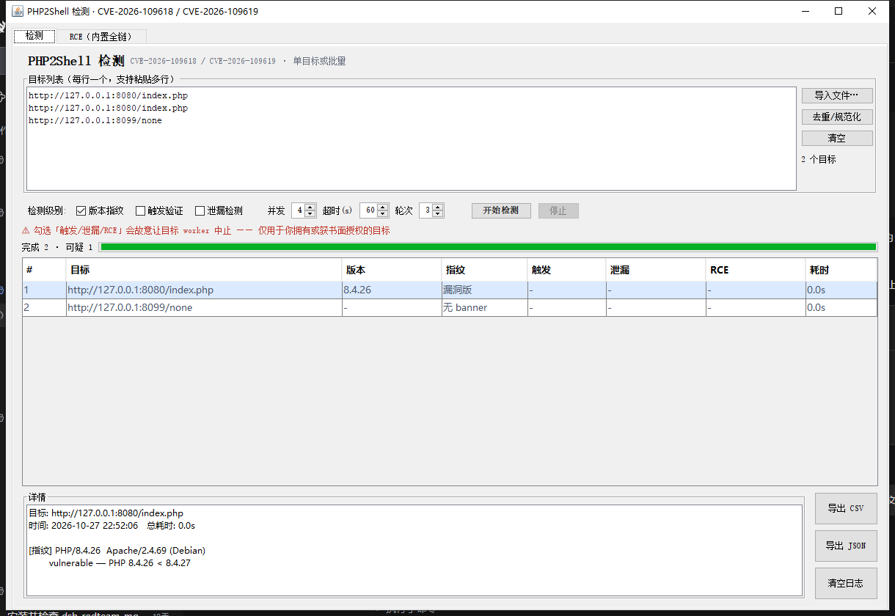
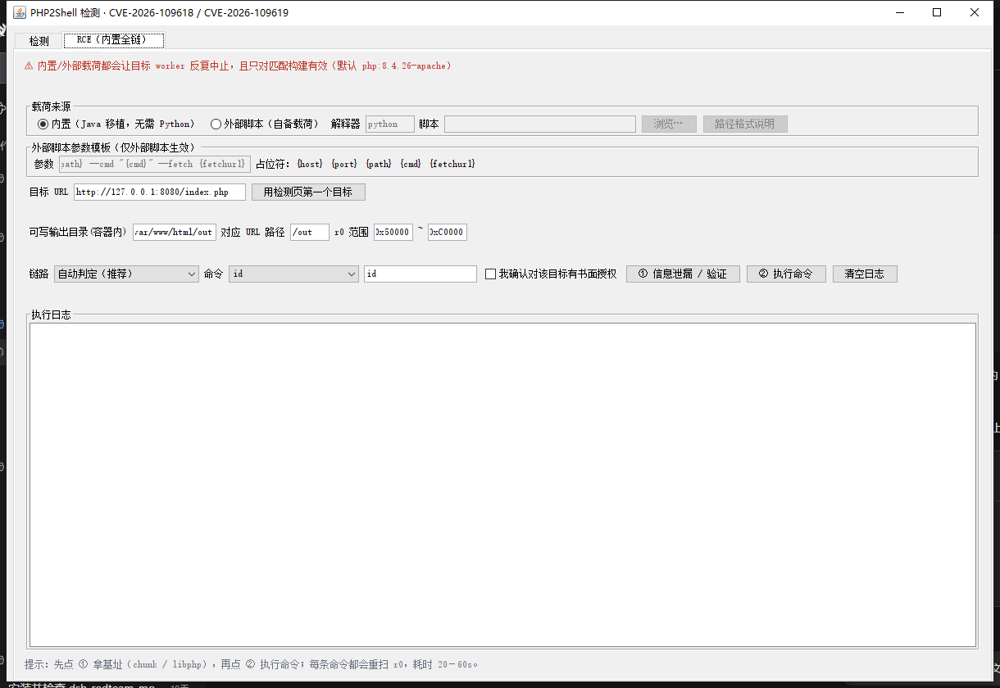

# p2s-detector —— PHP2Shell（CVE-2026-109618 / CVE-2026-109619）检测与验证工具

一个单文件可执行 jar，Swing 界面，零第三方依赖。用于**授权范围内**检测与验证 PHP 请求生命周期漏洞
（内存耗尽 bailout 留下不一致状态），覆盖单目标与批量。

> ⚠️ **仅限授权测试**。工具会主动让目标 PHP worker 中止（OOM），批量使用会影响业务可用性。
> 使用前请确认你有书面授权，并优先在自建靶机验证。作者不对任何滥用负责。



## 功能

| 能力 | 说明 |
|---|---|
| **批量检测** | 每行一个目标 / 导文件 / 去重规范化；并发、超时、轮次可调 |
| **三级检测** | 版本指纹 → 触发验证 → 泄漏检测，逐级增强侵入性 |
| **链路自动判定** | 探测目标后判定走哪条链（跨请求脏状态 / 同请求 teardown） |
| **RCE 验证** | 内置 Java 全链载荷（无需 Python），或挂你自己的脚本 |
| **可导出** | 结果导出 CSV / JSON；日志可复制、另存、清空 |

## 运行环境

| 项 | 要求 |
|---|---|
| JRE | **Java 15+**（源码使用 text block；JDK 19 实测） |
| 依赖 | 无（仅标准库） |
| 平台 | Windows / Linux / macOS |

## 快速开始

```bash
# Windows：构建（输出 p2s-detector.jar）
build.cmd

# 双击运行，或：
java -jar p2s-detector.jar
```

构建产物与 `out/` 已在 `.gitignore` 中——仓库只放源码，避免二进制与源码不同步。

## 界面



| 页签 | 用途 |
|---|---|
| **检测** | 目标列表（单行/多行/导入）、三级开关、并发、结果表、详情、导出 |
| **RCE** | 单目标、载荷来源（内置/外部）、链路判定、命令执行、执行日志 |

## 三级检测

| 级别 | 做什么 | 判据 | 侵入性 |
|---|---|---|---|
| **L1 版本指纹** | 读 `X-Powered-By` / `Server` / 正文 banner | `< 8.2.35 / 8.3.36 / 8.4.27 / 8.5.12` | 无 |
| **L2 触发验证** | 发 multipart，让请求在**启动期**耗尽内存 | 响应含 `in Unknown on line 0` + worker 是否存活 | 中止 worker 一次 |
| **L3 泄漏检测** | 对比干净 worker 与中止后的 cookie | `leak` / `differential` / `corruption-or-exit` / `no-signal` | 多次中止 |

> L2 的 `in Unknown on line 0` **不能单独证明漏洞存在**——已打补丁的版本同样会记录这一行
> （只是改成申请一个可失败的整块）。判定要看版本 + 脏状态是否跨请求存活。

## RCE 页签

### 载荷来源：内置 / 外部

| 选项 | 说明 |
|---|---|
| **内置（Java 移植，无需 Python）** | 整条链在 `RceEngine.java` 里，开箱可用 |
| **外部脚本（自备载荷）** | 按参数模板调用你的脚本/PoC |

外部脚本的路径写法（工具会自动去引号、把相对路径转绝对路径）：

```
D:\tools\exploit.py                       绝对路径（推荐）
"D:\My Tools\exploit.py"                  含空格可加引号
poc\exploit.py                            相对路径（相对启动目录）
```

模板占位符：`{host}` `{port}` `{path}` `{cmd}` `{fetchurl}`。
脚本执行后工具按 `{fetchurl}` 回读命令输出；取不到则把脚本 stdout 当结果。

### 链路自动判定

| 判定 | 含义 | 行为 |
|---|---|---|
| **A** | 跨请求脏状态可被消费（`PS(id)` 悬垂 → filler 回收，session 路径） | **真的执行命令** |
| **B** | 同请求 teardown 被破坏（bucket 未初始化，worker 被打死/连接重置） | **只检出**，不武器化 |
| **none** | 两条都不成立 | 报告原因（`memory_limit`、请求体限制、WAF、构建不匹配） |

判定顺序：启动期 OOM → A 链夺堆 → B 链破坏。以 **A 链夺堆**为准：中止请求的响应体可能读不到
fatal（连接被重置时很常见），但泄漏成功本身就证明前置条件成立。

> **诚实说明**：B 链（同请求 teardown → 伪造 zval → 对象 dtor）公开资料没有可用武器化实现，
> 本工具也**没有**做到。所以 B 链只提供「促发 + 检出」，不会伪装成能执行命令。

### 能执行什么、不能执行什么

| 能做 | 说明 |
|---|---|
| 任意命令（`system()` 语义） | 以 PHP worker 身份执行，通常是 `www-data` |
| 读文件 / 环境变量 | 受 `open_basedir` 限制；`env` 常含 DB 口令与 API key |
| 枚举进程与监听 | `ps aux`、`ss -lntp` → 内网可达服务 |
| 写文件 | 仅限 worker 可写目录（webroot 可写即可落 webshell） |

| 做不到 | 原因 |
|---|---|
| 直接逃逸容器 | 无 docker socket、无特权挂载 |
| 读宿主机文件 | 容器隔离 |
| `disable_functions` 禁用 `system` 时执行命令 | 载荷走 `zif_system`，会落到桩函数上（此时能证明可达，但打不出任意命令） |
| 持久化 shell | 每次执行都是一次完整利用，无常驻通道 |

## 命令行自检（不开界面）

```bash
java -jar p2s-detector.jar --selftest http://127.0.0.1:8080/index.php
# 指纹: version=PHP/8.4.26 verdict=vulnerable  0.07s

# 跑指定级别（可接 CI）
java -jar p2s-detector.jar --probe http://127.0.0.1:8080/index.php fingerprint,trigger,leak

# 只判定链路 / 判定后直接执行
java -jar p2s-detector.jar --chain    http://127.0.0.1:8080/index.php
java -jar p2s-detector.jar --rce-auto http://127.0.0.1:8080/index.php id

# 用外部脚本（模板默认兼容常见 PoC 的 --host/--port/--path/--cmd/--fetch）
java -jar p2s-detector.jar --rce-ext http://127.0.0.1:8080/index.php poc/exploit.py id

# 自检
java -jar p2s-detector.jar --logcheck          # 清空日志功能
java -jar p2s-detector.jar --fontcheck f.png   # 中文字体（是否豆腐块）
java -jar p2s-detector.jar --demo out.png      # 渲染界面截图
java -jar p2s-detector.jar --help
```

## 目录结构

```
.
├── build.cmd / run.cmd          # Windows 构建与启动
├── src/p2s/
│   ├── Main.java                # 入口、无界面模式、自检
│   ├── MainFrame.java           # 检测页（列表、表格、导出）
│   ├── Probe.java               # L1–L3 探测与 HTTP 客户端
│   ├── RceEngine.java           # 内置全链载荷 + 链路判定
│   └── RcePanel.java            # RCE 页（载荷来源、链路、命令）
├── docs/screenshots/            # 界面截图
└── README.md
```

## 已知限制

- **对目标构建极度敏感**：内置载荷的偏移与 filler 数量是按特定官方镜像调校的；同版本但不同
  构建方式（bind mount、不同 ini、不同 Apache 配置）也会失败。同一镜像、同一份 223 条 ini
  指令、同一个 PHP 二进制，换一个干净容器就可能打不通——这不是参数问题，是运行时堆状态问题。
- **B 链未武器化**（见上）。
- 远程无法可靠判断 `opcache` / worker 模型，判定靠行为推断。

## 许可

仓库不含任何第三方载荷代码；内置链为独立移植实现。使用时请遵守目标所在司法辖区的法律与授权范围。
如需许可证，建议自行添加（MIT / Apache-2.0 均可）。
